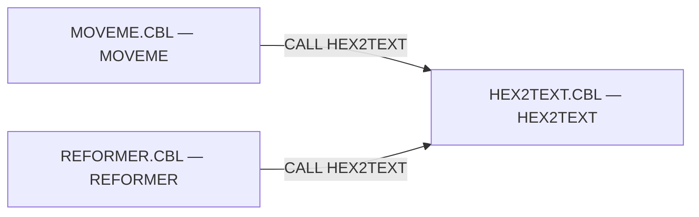

# Documentation technique d’architecture — dépôt COBOL

## Table des matières

- [1. Introduction](#1-introduction)
  - [Contexte](#contexte)
  - [Description fonctionnelle succincte](#description-fonctionnelle-succincte)
- [2. Cartographie des liens entre programmes](#2-cartographie-des-liens-entre-programmes)
  - [Rôles dans le corpus](#rôles-dans-le-corpus)
  - [Graphe des appels](#graphe-des-appels)
  - [Éléments externes ou absents](#éléments-externes-ou-absents)
- [3. Analyse détaillée par fichier](#3-analyse-détaillée-par-fichier)
- [4. Fichiers principaux non `.CBL` et non `.CPY`](#4-fichiers-principaux-non-cbl-et-non-cpy)

## 1. Introduction

### Contexte

Le dépôt contient quinze sources COBOL `.CBL` et un document Word. Les commentaires des sources décrivent principalement des exemples de langage et de programmation COBOL : calculs, traitement de dates et de textes, structures de données, fichiers séquentiels et conversions numériques.

L’ensemble forme un corpus cohérent d’exemples, avec un utilitaire partagé (`HEX2TEXT`), mais pas une application métier unique. Aucun programme maître, scénario d’exécution global, copybook `.CPY`, script de compilation ni fichier de données n’est présent dans l’inventaire du dépôt. Les modalités de compilation, de déploiement et l’environnement COBOL cible ne peuvent donc pas être établis à partir des sources seules.

### Description fonctionnelle succincte

Les programmes illustrent des traitements autonomes :

- calculs scientifiques et métier (`ATTRACT`, `BRAKES`, `INVCALC`) ;
- manipulation et conversion de données (`MOVEME`, `REFORMER`, `STRINGIT`, `HELLO`) ;
- dates et heure (`DATE1`, `DATE2`) ;
- conditions et représentations de booléens (`COND88`, `IFEVAL.CBL`, `NOTBOOL`) ;
- lecture et écriture de fichiers séquentiels à enregistrements fixes ou variables (`CPSEQFR`, `CPSEQVR`).

La seule réutilisation interprogramme visible est l’appel à `HEX2TEXT` depuis `MOVEME` et `REFORMER`. Les autres interactions observées sont des entrées/sorties console ou des fichiers séquentiels externes.

## 2. Cartographie des liens entre programmes

### Rôles dans le corpus

La classification ci-dessous décrit le rôle pédagogique ou technique des sources ; elle ne représente pas un ordre d’exécution ou une hiérarchie déclarée dans le code.

| Rôle documentaire | Programmes | Responsabilité illustrée |
|---|---|---|
| Fondamentaux COBOL | `COND88`, `IFEVAL.CBL`, `NOTBOOL`, `DATE1`, `DATE2`, `HELLO`, `STRINGIT` | Conditions, booléens, dates, saisie et manipulation de chaînes. |
| Traitements composés / intermédiaires | `MOVEME`, `REFORMER`, `INVCALC`, `CPSEQFR`, `CPSEQVR` | Conversion de représentations, transformation d’enregistrements, calcul de facture et E/S séquentielles. `MOVEME` et `REFORMER` utilisent le composant partagé. |
| Exemples spécialisés | `ATTRACT`, `BRAKES` | Calcul d’attraction gravitationnelle et estimation de l’échauffement de freins. |
| Support réutilisable | `HEX2TEXT` | Conversion d’octets en caractères hexadécimaux, appelée par deux programmes. |

Il n’existe pas de chaîne de traitement reliant tous les programmes. Hormis les deux appels représentés ci-dessous, les sources sont indépendantes au regard des appels COBOL visibles.

### Graphe des appels

`MOVEME` contient plusieurs appels à `HEX2TEXT` pour afficher les représentations hexadécimales de différents éléments. `REFORMER` l’appelle une fois pour afficher la représentation de l’enregistrement transformé.

### Éléments externes ou absents

- **Appels à des programmes absents :** aucun appel `CALL` vers un programme non présent dans le dépôt n’est visible. Les appels COBOL trouvés ciblent `HEX2TEXT`, dont la source est fournie.
- **Fichiers de données attendus à l’exécution :** les noms ci-dessous apparaissent dans les clauses `ASSIGN`, mais les fichiers correspondants ne sont pas fournis. Ce sont des dépendances de données, pas des programmes appelés.

| Programme | Rôle | Contrat visible |
|---|---|---|
| `CPSEQFR` | `INFILE1` en entrée, `OUTFILE1` en sortie | Enregistrements séquentiels fixes de 40 caractères. |
| `CPSEQVR` | `VARFILE1` en entrée, `VARFILE2` en sortie | Enregistrements séquentiels variables de 5 à 50 caractères. |

- **Copybooks :** aucun fichier `.CPY` ni instruction `COPY` n’est présent dans les sources inventoriées ; les structures sont déclarées localement.
- **Référence documentaire non fournie :** le commentaire de `MOVEME.CBL` cite `MOVE-notes.md`, absent de l’inventaire. Cette référence n’est pas une dépendance d’exécution.

## 3. Analyse détaillée par fichier

### ATTRACT.CBL — `ATTRACT`

- **Objectif fonctionnel :** demander les attributs de deux corps, afficher les valeurs saisies, puis calculer leur distance et une force d’attraction gravitationnelle. L’utilisateur peut interrompre le calcul avant cette étape.
- **Structures clés :** table `Body OCCURS 2` avec masse, vitesses et positions en `COMP-2` ; constantes, zones de saisie et messages d’affichage dans le Working-Storage.
- **Mécanismes COBOL :** `ACCEPT`, `DISPLAY`, `PERFORM VARYING`, `COMPUTE` et fonctions intrinsèques `SQRT`, `ATAN`, `COS`, `SIN`. Le cas de distance nulle est traité avant le calcul de la force.
- **Relation avec les autres programmes :** programme autonome, sans fichier ni appel à un autre programme du dépôt. Le commentaire du code précise que le calcul de direction est une approximation de démonstration : `ATAN2` est laissé en commentaire et les composantes utilisent `ATAN(dx)`.

### BRAKES.CBL — `BRAKES`

- **Objectif fonctionnel :** estimer la variation de température des freins d’un camion après une descente, à partir de valeurs numériques définies dans le programme.
- **Structures clés :** constantes de masse, chaleur spécifique, poids, dénivelé et accélération ; résultats intermédiaires `Mgh`, `mc` et `deltaT-Celsius`.
- **Mécanismes COBOL :** calculs en `COMP-2` avec `COMPUTE`, puis transfert vers une zone numérique formatée pour l’affichage.
- **Relation avec les autres programmes :** traitement autonome, sans saisie, fichier ni appel interprogramme visible.

### COND88.CBL — `COND88`

- **Objectif fonctionnel :** illustrer les noms de condition de niveau 88 ; le programme ne produit pas de sortie.
- **Structures clés :** champs alphanumériques et numériques associés à des conditions 88 pour des indicateurs, des catégories et des plages d’âge.
- **Mécanismes COBOL :** `SET ... TO TRUE/FALSE`, tests de conditions 88 et `EVALUATE TRUE` avec valeurs multiples ou plages.
- **Relation avec les autres programmes :** exemple autonome, sans appel interprogramme visible.

### CPSEQFR.CBL — `CPSEQFR`

- **Objectif fonctionnel :** lire des enregistrements fixes, permuter leurs deux champs et écrire les enregistrements transformés, en comptant les traitements.
- **Structures clés :** `INPUT-RECORD` de 40 caractères (`10 + 30`) et `OUTPUT-RECORD` de 40 caractères (`30 + 10`) ; états de fichier définis par `FILE STATUS`.
- **Mécanismes COBOL :** `SELECT`, descripteurs `FD`, `OPEN`, `READ`, `WRITE`, `CLOSE`, noms de condition 88 pour les statuts et boucle jusqu’à la fin de fichier.
- **Relation avec les autres programmes :** aucun appel à un autre programme. Le traitement dépend des fichiers externes `INFILE1` et `OUTFILE1`, qui ne sont pas livrés.

### CPSEQVR.CBL — `CPSEQVR`

- **Objectif fonctionnel :** lire des enregistrements variables, leur ajouter le champ `XXXXX`, puis écrire les résultats et afficher le nombre d’enregistrements traités.
- **Structures clés :** longueur d’enregistrement dépendante (`5` à `50`), zone de dix champs de cinq caractères au maximum, compteurs de champs et statuts de fichiers.
- **Mécanismes COBOL :** E/S séquentielles, `RECORD IS VARYING ... DEPENDING ON`, table `OCCURS ... DEPENDING ON`, calculs de longueur et ajout d’un champ.
- **Relation avec les autres programmes :** aucun appel interprogramme visible ; dépend de `VARFILE1` et `VARFILE2`, absents du dépôt. Le commentaire d’en-tête indique `CPSEQFR`, alors que le `PROGRAM-ID` déclaré est `CPSEQVR`. Le calcul suppose une longueur d’entrée multiple de cinq et, puisque le programme ajoute un champ de cinq caractères dans une table de dix éléments et une sortie plafonnée à 50 caractères, une entrée ne dépassant pas 45 caractères. Ces contraintes ne sont pas validées explicitement.

### DATE1.CBL — `DATE1`

- **Objectif fonctionnel :** obtenir la date et l’heure courantes et en afficher plusieurs représentations, dont un horodatage de type NCSA, une date en toutes lettres et des formats US et européen.
- **Structures clés :** zones décomposant `CURRENT-DATE` (date, heure et fuseau), tableaux de noms de mois et de suffixes ordinaux, zones de sortie formatées.
- **Mécanismes COBOL :** fonction intrinsèque `CURRENT-DATE`, `MOVE CORRESPONDING`, `REDEFINES`, `DIVIDE`, `STRING` et références modifiées.
- **Relation avec les autres programmes :** exemple autonome, sans appel interprogramme. Le suffixe ordinal est sélectionné à partir du dernier chiffre du jour selon la table déclarée dans le programme.

### DATE2.CBL — `DATE2`

- **Objectif fonctionnel :** récupérer les valeurs de date, de jour et d’heure par les formes prédéfinies de `ACCEPT`, puis afficher des formats textuels, US, européen et une heure au centième de seconde.
- **Structures clés :** zones de réception pour `DATE`, `DATE YYYYMMDD`, `DAY`, `DAY YYYYDDD`, `DAY-OF-WEEK` et `TIME` ; tableaux de noms de jours et de mois.
- **Mécanismes COBOL :** `ACCEPT ... FROM`, `REDEFINES`, `STRING`, `DIVIDE` et références modifiées.
- **Relation avec les autres programmes :** exemple autonome, sans appel interprogramme visible.

### HELLO.CBL — `HELLO`

- **Objectif fonctionnel :** lire un nom et afficher un message de salutation en retirant les espaces de fin du champ saisi.
- **Structures clés :** prompt, zone du nom, constantes de salutation et zone de message.
- **Mécanismes COBOL :** `DISPLAY`, `ACCEPT`, `INSPECT` appliqué à `FUNCTION REVERSE`, `STRING` et référence modifiée.
- **Relation avec les autres programmes :** entrée/sortie console seulement ; aucun appel à un autre programme du dépôt.

### HEX2TEXT.CBL — `HEX2TEXT`

- **Objectif fonctionnel :** convertir chaque octet d’une valeur fournie en deux caractères hexadécimaux majuscules.
- **Structures clés :** zone `LINKAGE` `LS-HEX2TEXT-CONVERSION` contenant la longueur d’origine, une valeur de 120 caractères et un résultat de 240 caractères ; zone de travail redéfinissant un entier binaire en octets.
- **Mécanismes COBOL :** `PROCEDURE DIVISION USING`, `REDEFINES`, boucle `PERFORM VARYING`, divisions avec quotient et reste et références modifiées dans la table `HEXSTR`.
- **Relation avec les autres programmes :** composant partagé appelé par `MOVEME` et `REFORMER`. Les deux appelants transmettent une zone structurée de même forme. Aucune entrée/sortie fichier n’est réalisée par ce programme.

### IFEVAL.CBL — `PROGRAM-ID` déclaré `COND88`

- **Objectif fonctionnel :** illustrer des comparaisons alphanumériques et numériques, des tests de validité numérique, une protection contre une division par zéro et plusieurs formes d’`EVALUATE`. Le programme ne produit pas de sortie.
- **Structures clés :** champs de comparaison alphanumériques, champs numériques signés `COMP-3` et zone de travail pour vérifier la validité numérique.
- **Mécanismes COBOL :** `IF/ELSE`, conditions `IS NUMERIC`, `DIVIDE`, `SUBTRACT`, `EVALUATE TRUE` et `EVALUATE TRUE ALSO TRUE`.
- **Relation avec les autres programmes :** aucun appel interprogramme visible. Le nom de fichier est `IFEVAL.CBL`, mais son identifiant déclaré est `COND88`, identique à celui de `COND88.CBL` ; cela peut créer un conflit si les deux unités sont réunies dans un même ensemble de compilation ou de chargement.

### INVCALC.CBL — `INVCALC`

- **Objectif fonctionnel :** calculer et afficher les totaux d’une facture d’exemple : montant avant taxe, taxe de vente et montant total.
- **Structures clés :** groupe `INVOICE` avec jusqu’à 100 lignes, quantités, prix unitaires et indicateurs taxables ; champs de calcul et zones d’affichage formatées. Les données de l’exemple sont initialisées dans le programme.
- **Mécanismes COBOL :** `COMP-3`, `OCCURS ... DEPENDING ON`, niveaux 88, `INITIALIZE`, contrôles `IS NUMERIC`, calculs et accumulations, `PERFORM` et paragraphes dédiés à l’erreur et à l’affichage.
- **Relation avec les autres programmes :** exemple autonome, sans fichier ni appel interprogramme. **Point de vigilance :** l’initialisation de la troisième ligne exécute `SET TAXABLE-ITEM(1) TO TRUE` ; le code ne marque donc pas la troisième ligne taxable, tandis que la première est désignée deux fois.

### MOVEME.CBL — `MOVEME`

- **Objectif fonctionnel :** montrer les effets de `MOVE` sur différentes représentations de données et afficher les octets de certaines zones en hexadécimal.
- **Structures clés :** exemples `COMP`, `COMP-3`, `COMP-1`, `COMP-2` et numériques d’affichage ; groupes redéfinis pour observer des représentations mémoire ; contrat de zone partagé avec `HEX2TEXT`.
- **Mécanismes COBOL :** `MOVE`, `INITIALIZE`, niveaux 88, table dépendante, `LENGTH OF`, références modifiées et appels `CALL 'HEX2TEXT'`.
- **Relation avec les autres programmes :** appelle `HEX2TEXT` à plusieurs endroits. Les valeurs illustrées sont définies dans la source ; aucun fichier de données n’est lu.

### NOTBOOL.CBL — `NOTBOOL`

- **Objectif fonctionnel :** présenter plusieurs conventions de représentation d’un booléen dans des champs COBOL, sans produire de sortie.
- **Structures clés :** indicateurs `PIC X`, valeurs de vérité configurables, conditions 88 et indicateurs numériques signés ; l’exemple de champ `BIT` est commenté.
- **Mécanismes COBOL :** comparaisons, `IF`, `EVALUATE`, `SET` sur conditions 88 et calcul pour basculer une valeur numérique. Le commentaire de la source signale une incompatibilité de l’exemple `BIT` avec GnuCOBOL.
- **Relation avec les autres programmes :** exemple autonome, sans appel interprogramme visible.

### REFORMER.CBL — `REFORMER`

- **Objectif fonctionnel :** illustrer la transformation d’un enregistrement externe en structure interne : conversion de date, recherche d’un préfixe produit, normalisation d’un indicateur taxable et conversion de champs numériques.
- **Structures clés :** groupes `INPUT-RECORD` et `OUTPUT-RECORD`, table de correspondance des préfixes SKU et zone de travail compatible avec le contrat de `HEX2TEXT`.
- **Mécanismes COBOL :** `UNSTRING`, `SEARCH`, `STRING`, `SET` sur une condition 88, `MOVE`, références modifiées et `CALL 'HEX2TEXT'`. L’entrée d’exemple est affectée par des littéraux ; aucune lecture de fichier n’est présente.
- **Relation avec les autres programmes :** appelle `HEX2TEXT` pour afficher l’enregistrement interne en hexadécimal. Pour la date `MM/DD/YY`, le programme préfixe l’année fournie avec le siècle obtenu par `CURRENT-DATE` ; aucune règle de bascule de siècle n’est visible.

### STRINGIT.CBL — `STRINGIT`

- **Objectif fonctionnel :** afficher un nom sous différents ordres et illustrer plusieurs façons de concaténer des champs textuels.
- **Structures clés :** champs séparés pour prénom, deuxième prénom et nom de famille, zone de sortie et compteurs de longueurs.
- **Mécanismes COBOL :** `MOVE`, `INITIALIZE`, `INSPECT ... TALLYING`, `STRING`, délimiteurs et références modifiées.
- **Relation avec les autres programmes :** exemple autonome fondé sur des valeurs définies dans le programme ; aucun appel interprogramme ni fichier externe.

## 4. Fichiers principaux non `.CBL` et non `.CPY`

| Fichier | Rôle dans le dépôt |
|---|---|
| `documentation Type COBOL.docx` | Trame de documentation technique : elle fournit des rubriques d’introduction, de cartographie et de description des programmes, avec des textes d’instruction à compléter. Ce n’est ni un copybook ni une dépendance d’exécution. |

Aucun fichier `.CPY` ou autre fichier de données n’est présent dans l’inventaire. Les jeux de données attendus par `CPSEQFR` et `CPSEQVR` doivent donc être fournis séparément lors d’une éventuelle exécution.
