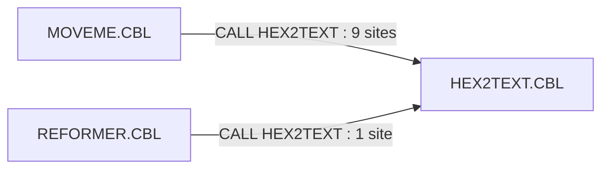
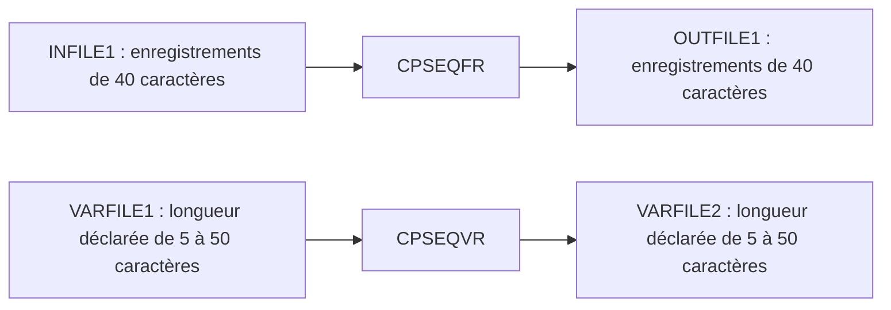

# Documentation technique du projet COBOL

## Table des matières

- [1. Introduction](#1-introduction)
- [2. Cartographie des liens entre programmes](#2-cartographie-des-liens-entre-programmes)
- [3. Analyse détaillée par fichier](#3-analyse-détaillée-par-fichier)
- [4. Fichiers principaux à retenir](#4-fichiers-principaux-à-retenir)

## 1. Introduction

### 1.1. Contexte

Le dépôt contient **15 sources `.CBL`**, toutes placées à la racine, et un modèle de documentation Word. Aucun copybook `.CPY` n'est fourni. Le périmètre de cette analyse est limité aux fichiers du dépôt ; aucune spécification métier extérieure n'est supposée.

Les commentaires des programmes présentent explicitement des démonstrations du langage COBOL. L'ensemble constitue un **corpus technique cohérent** : représentation des données, contrôle du traitement, manipulation de texte et de dates, transformations d'enregistrements, entrées/sorties séquentielles et calculs. Les sources suivent généralement le même canevas : identification, données de travail, procédure et sortie par `GOBACK`.

**Interprétation technique :** la cohérence du projet est pédagogique et technique, plutôt que celle d'une application métier intégrée. Le code ne matérialise ni programme maître, ni ordonnancement global, ni chaîne de facturation complète. Il ne faut donc pas transformer les parentés entre exemples en dépendances d'exécution fictives.

### 1.2. Description fonctionnelle succincte

Le corpus illustre le passage des mécanismes élémentaires aux traitements plus structurés :

- affecter, comparer et interpréter des données COBOL, notamment les représentations binaires, décimales et les indicateurs de niveau `88` ;
- construire des messages, reformater des dates et adapter un enregistrement produit/facture ;
- transformer des fichiers séquentiels à longueur fixe ou variable ;
- appliquer des calculs de facture, de gravitation et d'échauffement.

Les entrées sont des valeurs codées dans les sources, des saisies par `ACCEPT`, des informations de date/heure du système ou des enregistrements séquentiels. Les sorties sont principalement des `DISPLAY` ; seuls `CPSEQFR` et `CPSEQVR` écrivent des fichiers. `COND88`, `IFEVAL` et `NOTBOOL` modifient uniquement leurs données internes, sans restitution.

## 2. Cartographie des liens entre programmes

### 2.1. Programmes de base, intermédiaires et spécialisés

La classification suivante décrit les responsabilités et la complexité des exemples. **Elle ne représente pas une hiérarchie d'appels.**

| Niveau de lecture | Sources | Responsabilité dans l'ensemble |
| --- | --- | --- |
| Base : données et contrôle | `MOVEME.CBL`, `COND88.CBL`, `IFEVAL.CBL`, `NOTBOOL.CBL` | Affectations, représentations mémoire, comparaisons et conventions de vérité. |
| Base : texte et temps | `HELLO.CBL`, `STRINGIT.CBL`, `DATE1.CBL`, `DATE2.CBL` | Saisie et assemblage de texte, accès à l'horloge et mise en forme des dates. |
| Intermédiaire : transformation | `REFORMER.CBL`, `CPSEQFR.CBL`, `CPSEQVR.CBL` | Combinaison des mécanismes de base pour adapter des structures et traiter des flux séquentiels. |
| Spécialisé : calcul | `INVCALC.CBL`, `ATTRACT.CBL`, `BRAKES.CBL` | Calculs décimaux de facture ou calculs scientifiques en virgule flottante. |
| Spécialisé : service transversal | `HEX2TEXT.CBL` | Conversion d'octets en caractères hexadécimaux pour l'observation des données de deux programmes appelants. |

### 2.2. Appels entre programmes attestés

Les seuls appels inter-programmes sont les **10 instructions `CALL 'HEX2TEXT'`** : neuf dans `MOVEME.CBL`, une dans `REFORMER.CBL`.

Les appels sont visibles dans [MOVEME.CBL](./MOVEME.CBL#L83-L221) et [REFORMER.CBL](./REFORMER.CBL#L190-L192). `HEX2TEXT` est le seul programme avec une `LINKAGE SECTION` et une `PROCEDURE DIVISION USING`. Les 14 autres sources ne déclarent pas de paramètre dans leur `PROCEDURE DIVISION`.

Les `PERFORM` nommés, par exemple `ComputeAttraction`, `INVALID-INVOICE-DATA` et `PRINT-INVOICE-DETAILS`, désignent des paragraphes **internes** à leur programme, pas des modules supplémentaires. Aucun appel entre les autres sources n'est présent.

### 2.3. Contrat partagé avec HEX2TEXT

`MOVEME` et `REFORMER` déclarent chacun un groupe `WS-HEX2TEXT-CONVERSION`, transmis par référence implicite à `LS-HEX2TEXT-CONVERSION` :

| Champ du sous-programme | Déclaration | Sens |
| --- | --- | --- |
| `LS-ORIGINAL-LENGTH` | `PIC S9(09) COMP` | Nombre d'octets à convertir, fourni par l'appelant. |
| `LS-ORIGINAL-VALUE` | `PIC X(120)` | Zone source contenant les octets à examiner. |
| `LS-RESULT` | `PIC X(240)` | Zone résultat, alimentée à raison de deux caractères hexadécimaux par octet. |

Les trois déclarations sont compatibles dans les sources, mais **dupliquées sans copybook commun**. Leur synchronisation doit être préservée lors d'une modification. Pour une longueur `n`, la partie produite du résultat est `LS-RESULT(1:2*n)` ; le reste n'est pas effacé par le sous-programme.

La capacité des zones impose une longueur utile au plus égale à 120, sans contrôle de borne dans `HEX2TEXT`. Aucun code d'erreur ni paramètre de statut n'est prévu. Le dépôt ne fournit pas les options déterminant la résolution du `CALL` : il ne permet pas de conclure à une liaison statique ou à un chargement dynamique.

### 2.4. Flux de fichiers et parentés fonctionnelles

Les deux traitements séquentiels ont des flux distincts :

`CPSEQFR` permute deux champs de 10 et 30 caractères. `CPSEQVR` découpe implicitement ses données en champs de cinq caractères et ajoute `XXXXX`. **Aucun fichier produit par l'un n'est désigné comme entrée de l'autre.** Les noms ci-dessus sont les littéraux des clauses `ASSIGN`, pas des chemins de déploiement documentés.

Les rapprochements suivants expliquent la cohérence du corpus, sans ajouter de flux au graphe :

| Famille | Lien fonctionnel ou technique observable | Limite de l'interprétation |
| --- | --- | --- |
| `DATE1` / `DATE2` | Même objectif de présentation de la date, tables de mois et de suffixes similaires ; acquisition par fonction intrinsèque ou par `ACCEPT`. | Alternatives autonomes, sans appel ni table partagée par `COPY`. |
| `HELLO` / `STRINGIT` / `REFORMER` | Assemblage et découpage de chaînes par `STRING`, `INSPECT`, `UNSTRING` ou modification de référence, selon le programme. | Progression technique, pas chaîne de transformation exécutée entre les trois. |
| `COND88` / `NOTBOOL` / `IFEVAL` et traitements composés | Les conditions, indicateurs et tests illustrés se retrouvent notamment dans les statuts de fichiers et les indicateurs de taxe. | Réemploi de mécanismes COBOL, pas de sous-programme de contrôle commun. |
| `REFORMER` / `INVCALC` | Vocabulaire commun : produit, facture, quantité, prix et caractère taxable. | Les structures diffèrent ; aucun contrat de transfert, appel ou fichier commun ne relie ces traitements. |
| `ATTRACT` / `BRAKES` | Calcul scientifique fondé sur `COMP-2`. | Problèmes distincts ; aucune donnée échangée. |

En particulier, `REFORMER` ne doit pas être présenté comme un fournisseur d'enregistrements pour `INVCALC` : le numéro de facture est, par exemple, sur 16 caractères dans sa sortie, contre 8 dans `INVCALC`.

### 2.5. Appels externes et ressources absentes

**Aucun `CALL` ne cible un programme absent du dépôt.** La seule cible, `HEX2TEXT`, est fournie. Aucune instruction `COPY` n'est présente.

| Élément non fourni comme fichier du dépôt | Référence dans les sources | Nature de la dépendance |
| --- | --- | --- |
| `INFILE1` / `OUTFILE1` | `SELECT ... ASSIGN` dans `CPSEQFR` | Entrée séquentielle à fournir et sortie à produire ; affectation physique non documentée. L'absence de la sortie dans le dépôt n'est pas une absence de programme. |
| `VARFILE1` / `VARFILE2` | `SELECT ... ASSIGN` dans `CPSEQVR` | Même distinction pour les enregistrements variables ; aucun jeu de données ni paramétrage d'affectation n'est fourni. |
| `MOVE-notes.md` | Commentaire de [MOVEME.CBL, ligne 12](./MOVEME.CBL#L12) | Annexe explicative annoncée mais absente ; pas une dépendance d'exécution. |

Les fonctions `CURRENT-DATE` (`DATE1`, `REFORMER`), `REVERSE` (`HELLO`), `SQRT`, `ATAN`, `COS` et `SIN` (`ATTRACT`) sont des **fonctions intrinsèques COBOL**, non des programmes manquants. Les formes `ACCEPT ... FROM DATE`, `DAY`, `DAY-OF-WEEK` et `TIME` de `DATE2`, ainsi que les accès à la console, relèvent également de l'environnement d'exécution.

### 2.6. Contraintes d'intégration et d'exploitation

| Sujet | Constat et conséquence technique |
| --- | --- |
| Identité des modules | `IFEVAL.CBL` déclare `PROGRAM-ID. COND88`, comme `COND88.CBL`. Le nom de fichier ne suffit donc pas à identifier un module ; ce doublon expose à une collision lors d'une intégration commune. |
| Construction et lancement | Aucun script de compilation, fichier de construction, JCL, configuration d'exécution ou jeu d'essai n'est fourni. Aucune commande reproductible de construction ou de lancement ne peut être tirée du dépôt. |
| Plateforme | Les sources utilisent une présentation en colonnes, avec commentaires en colonne 7. Les mentions de QSAM, SYSIN/SYSOUT, GnuCOBOL et IBM Enterprise COBOL/z/OS dans les commentaires ne prouvent pas une cible de déploiement configurée. |
| Représentation mémoire | Les démonstrations hexadécimales dépendent de l'encodage et de la représentation des types numériques. L'hypothèse binaire de `HEX2TEXT` doit être vérifiée pour le compilateur cible. |
| État et persistance | Les données sont locales aux programmes, sauf le groupe transmis à `HEX2TEXT` et les fichiers séquentiels déclarés. Aucun accès à une base de données ni transaction distribuée n'apparaît. |
| Robustesse | Les exemples ne constituent pas une infrastructure de production : contrôles de bornes, initialisations, arrondis et traitements d'erreurs sont incomplets à plusieurs endroits, détaillés ci-dessous. |

## 3. Analyse détaillée par fichier

### 3.1. ATTRACT.CBL

**Programme :** `ATTRACT` ([source](./ATTRACT.CBL)).

- **Objectif fonctionnel :** saisir les caractéristiques de deux corps, les réafficher pour confirmation, puis calculer leur distance et une force d'attraction. Une réponse `n` ou `N` interrompt le traitement ; une distance nulle est signalée avant toute division par cette distance.
- **Structures clés :** `ComputationalWorkAreas` contient la constante `G = 6.67428e-11`, les distances, forces et résultats intermédiaires en `COMP-2`. `Body OCCURS 2 INDEXED BY BodyIx` porte masse, vitesses et positions sur deux axes. `GeneralWorkAreas` regroupe les messages et la confirmation.
- **Mécanismes COBOL :** `PERFORM VARYING`, paragraphes `SolicitAttributesOfBody`, `VerifyAttributesOfBody` et `ComputeAttraction`, `ACCEPT ... FROM CONSOLE`, `DISPLAY`, `COMPUTE`, fonctions `SQRT`, `ATAN`, `COS`, `SIN` et `GOBACK`.
- **Relations :** aucun appel à un autre programme ni accès à un fichier. Parenté technique avec `BRAKES` par l'emploi de calculs en virgule flottante.
- **Limites visibles :** les vitesses saisies ne participent à aucun calcul ; il n'y a pas de simulation temporelle. La norme suit `G * mass(1) * mass(2) / (d * d)`, mais la direction et les composantes sont explicitement qualifiées d'erronées dans le commentaire : `theta = ATAN(dx)`, `fx = COS(theta * f)`, `fy = SIN(theta * f)`. Ces sorties ne doivent pas être interprétées comme un modèle physique validé.

### 3.2. BRAKES.CBL

**Programme :** `BRAKES` ([source](./BRAKES.CBL)).

- **Objectif fonctionnel :** calculer une élévation de température du matériau de freinage à partir de valeurs constantes : masse du matériau 100 kg, capacité thermique spécifique 800, masse du camion 10 000 kg, dénivelé 75 m et accélération 9,8.
- **Structures clés :** `GIVEN-VALUES` regroupe les constantes en `COMP-2` ; `CALCULATED-VALUES` porte `Mgh`, `mc`, `deltaT-Celsius` et une zone d'édition `PIC Z,ZZ9.99`.
- **Mécanismes COBOL :** `COMPUTE Mgh = w * a * d`, calcul de `mc = m * sh`, division `Mgh / mc`, puis `MOVE` vers la zone éditée et `DISPLAY`.
- **Entrées/sorties et relations :** aucune saisie, aucun fichier et aucun `CALL`. Une variation de température est affichée ; le calcul en valeurs constantes donne 91,875 avant mise en forme.
- **Limites visibles :** aucune température initiale n'est utilisée : le résultat est une variation, pas une température finale absolue. La restitution est limitée à deux décimales et le programme ne comporte pas de scénario paramétrable.

### 3.3. COND88.CBL

**Programme :** `COND88` ([source](./COND88.CBL)).

- **Objectif fonctionnel :** démontrer les noms de condition de niveau `88`, avec valeur vraie simple, clause `FALSE`, ensembles de valeurs et intervalles d'âge.
- **Structures clés :** `THE-ANSWER PIC X(10)` reçoit les résultats internes ; des caractères portent les conditions `SIMPLE-88`, `SIMPLE-88-WITH-FALSE`, `CATEGORY-A` et `CATEGORY-B`. `PERSON-AGE PIC 9(03)` est associé à sept tranches d'âge.
- **Mécanismes COBOL :** `SET ... TO TRUE/FALSE`, `IF`, négation, `EVALUATE TRUE`, valeurs multiples et `VALUE ... THRU ...`.
- **Entrées/sorties et relations :** valeurs d'exemple internes, sans saisie, affichage, fichier ni appel. Les mêmes mécanismes servent aux statuts de fichiers et aux indicateurs de taxe ailleurs dans le corpus ; aucun code n'est partagé matériellement.
- **Limite d'intégration :** son `PROGRAM-ID` est également déclaré dans `IFEVAL.CBL`. Les deux fichiers ne constituent pas deux modules nommés distinctement dans l'état actuel.

### 3.4. CPSEQFR.CBL

**Programme :** `CPSEQFR` ([source](./CPSEQFR.CBL)).

- **Objectif fonctionnel :** lire `INFILE1`, permuter les deux champs de chaque enregistrement et écrire `OUTFILE1`, en comptant les écritures réussies.
- **Structures clés :** deux `FD` avec `RECORD CONTAINS 40 CHARACTERS` et `RECORDING MODE F`. L'entrée est structurée en `INPUT-FIRST-10 PIC X(10)` puis `INPUT-LAST-30 PIC X(30)` ; la sortie en `OUTPUT-FIRST-30 PIC X(30)` puis `OUTPUT-LAST-10 PIC X(10)`. Les statuts sont sur deux caractères et `RECORD-COUNT` est en `PIC S9(5) COMP-3`.
- **Mécanismes COBOL :** `SELECT ... ASSIGN`, `FILE STATUS`, conditions `88` pour `00` et `10`, `OPEN`, boucle `PERFORM UNTIL END-OF-INPUT`, `READ`, `MOVE`, `WRITE`, `CLOSE` et branchement vers `END-OF-PROGRAM`.
- **Relations :** traitement autonome, sans `CALL`. Il forme avec `CPSEQVR` les deux variantes de traitement séquentiel du corpus, mais n'utilise aucun de ses fichiers.
- **Limites visibles :** le compteur n'est pas explicitement initialisé. Un échec d'ouverture de la sortie est affiché sans arrêt immédiat. Les erreurs de lecture autres que la fin de fichier ne font pas l'objet d'une branche de sortie, ce qui peut empêcher la terminaison de la boucle. Le paragraphe final ferme les deux fichiers sans distinguer ceux dont l'ouverture a réussi.

### 3.5. CPSEQVR.CBL

**Programme :** `CPSEQVR` ([source](./CPSEQVR.CBL)). Le commentaire d'en-tête indique `CPSEQFR`, mais le `PROGRAM-ID` effectif est bien `CPSEQVR`.

- **Objectif fonctionnel :** lire les enregistrements variables de `VARFILE1`, leur ajouter un champ `XXXXX` et les écrire dans `VARFILE2`, avec comptage.
- **Structures clés :** deux zones `PIC X(50)` et deux `FD` en `RECORDING MODE V`, de longueur 5 à 50 selon `IN-RECLEN` et `OUT-RECLEN`. `RECORD-AREA` contient `RECORD-FIELD PIC X(05) OCCURS 1 TO 10 DEPENDING ON FIELD-COUNT`. Les statuts utilisent `00` et `10` ; les compteurs sont en `COMP-3`.
- **Mécanismes COBOL :** lecture séquentielle, calcul du nombre de champs par `IN-RECLEN / LENGTH OF RECORD-FIELD`, déplacement vers le groupe variable, incrément du nombre de champs, affectation de `XXXXX`, calcul de la longueur de sortie et `WRITE ... FROM RECORD-AREA`.
- **Relations :** aucun appel de programme. Variante complémentaire de `CPSEQFR`, avec longueurs variables plutôt que permutation d'un découpage fixe.
- **Préconditions techniques déduites :** pour conserver intégralement l'entrée et ajouter cinq caractères dans les limites déclarées, sa longueur doit être un multiple de cinq, au plus égal à 45. Ces conditions ne sont pas contrôlées : une entrée de 50 conduit à 11 champs et à une sortie de 55, hors des limites ; une longueur non multiple de cinq perd son reliquat lors du découpage.
- **Autres limites visibles :** `RECORD-COUNT` n'est pas explicitement initialisé ; le statut après écriture n'est pas vérifié et le compteur est incrémenté après chaque tentative. Comme dans `CPSEQFR`, une erreur de lecture distincte de la fin de fichier n'est pas traitée explicitement.

### 3.6. DATE1.CBL

**Programme :** `DATE1` ([source](./DATE1.CBL)).

- **Objectif fonctionnel :** obtenir la date/heure courante avec `FUNCTION CURRENT-DATE` et afficher un horodatage de type NCSA, une date développée en anglais, une date américaine `MM/DD/YY` et une date européenne `DD.MM.YY`.
- **Structures clés :** `CURRENT-DATE-DATA` décompose les 21 caractères en date, heure et décalage de fuseau. `NCSA-TIMESTAMP` fixe la présentation de l'horodatage. Deux groupes portent les dates abrégées ; les tables `MONTH-ENTRY OCCURS 12` et `DAY-ORDINAL OCCURS 10` servent à la date développée.
- **Mécanismes COBOL :** fonction intrinsèque, `REDEFINES`, champs qualifiés, `MOVE CORRESPONDING`, accès indicé aux tables, `DIVIDE ... REMAINDER`, `STRING` et `DISPLAY`.
- **Relations :** aucun `CALL` ni fichier. `DATE2` poursuit le même objectif par d'autres mécanismes d'acquisition ; `REFORMER` utilise également `CURRENT-DATE`, sans appeler `DATE1`.
- **Limites visibles :** `DAY-LAST-DIGIT` vaut de 0 à 9, mais est utilisé directement comme indice d'une table COBOL de dix éléments commençant à 1. Les jours 10, 20 et 30 conduisent donc à l'indice 0, et les suffixes sont décalés pour d'autres jours ; les exceptions anglaises 11 à 13 ne sont pas traitées explicitement. Le champ nommé `MILLISECONDS`, sur deux chiffres, correspond à la fraction en centièmes de seconde, non à des millisecondes.

### 3.7. DATE2.CBL

**Programme :** `DATE2` ([source](./DATE2.CBL)).

- **Objectif fonctionnel :** obtenir les données calendaires et horaires par `ACCEPT`, puis afficher une date développée avec jour de semaine, les deux formats abrégés et l'heure au centième de seconde.
- **Structures clés :** `DATE-DATA` contient les formes `YYMMDD`, `YYYYMMDD`, `YYDDD`, `YYYYDDD`, le jour de semaine et l'heure. Les tables de mois et de suffixes reprennent le principe de `DATE1` ; `DAY-NAME OCCURS 7` fournit les noms anglais des jours.
- **Mécanismes COBOL :** `ACCEPT ... FROM DATE`, `DATE YYYYMMDD`, `DAY`, `DAY YYYYDDD`, `DAY-OF-WEEK`, `TIME`, tables redéfinies, calcul du dernier chiffre du jour, `STRING`, `MOVE` et `DISPLAY`.
- **Relations :** pas d'appel ni de fichier ; alternative autonome à `DATE1`. Les dates ordinales acquises dans les groupes `DAY-*` ne sont pas utilisées dans les formats affichés.
- **Limites visibles :** le même accès `DAY-ORDINAL(DAY-LAST-DIGIT)` reproduit l'erreur d'indice et les problèmes de suffixes de `DATE1`. Les données sont acquises par plusieurs instructions successives, et non par une acquisition unique.

### 3.8. HELLO.CBL

**Programme :** `HELLO` ([source](./HELLO.CBL)).

- **Objectif fonctionnel :** demander un nom et construire une salutation `Hello, <nom>!`, sans insérer les espaces de remplissage terminaux du nom avant le point d'exclamation.
- **Structures clés :** `WS-FRIEND PIC X(80)`, message `WS-MESSAGE PIC X(120)`, textes constants et compteur `WS-TRAILING-SPACES PIC S9(05) COMP-3 VALUE ZERO`.
- **Mécanismes COBOL :** `ACCEPT`, `INSPECT FUNCTION REVERSE(...) TALLYING ... FOR LEADING SPACES`, calcul de longueur utile, modification de référence et `STRING ... DELIMITED BY SIZE`.
- **Entrées/sorties et relations :** saisie et affichage, sans `SELECT` ni `CALL`. Le programme illustre les mécanismes de texte également employés par `STRINGIT` et, pour l'assemblage, par `REFORMER`.
- **Limite visible :** une saisie vide ou entièrement composée d'espaces produit une longueur utile nulle pour la modification de référence ; aucun traitement particulier de ce cas n'est codé.

### 3.9. HEX2TEXT.CBL

**Programme :** `HEX2TEXT` ([source](./HEX2TEXT.CBL)).

- **Objectif fonctionnel :** convertir les octets reçus en caractères hexadécimaux majuscules. Il s'agit d'une représentation de la mémoire, pas du décodage d'une chaîne hexadécimale ni d'une conversion entre ASCII et EBCDIC.
- **Structures clés :** interface `LS-HEX2TEXT-CONVERSION` décrite en section 2.3 ; alphabet `HEXSTR PIC X(16) VALUE "0123456789ABCDEF"` ; entier `DEC PIC S9(4) COMP`, redéfini pour accéder à son second octet par `DECBYTE` ; indices, quotient et reste.
- **Mécanismes COBOL :** `LINKAGE SECTION`, `PROCEDURE DIVISION USING`, `PERFORM VARYING`, modification de référence, `REDEFINES` et division par 16 pour sélectionner les deux chiffres de chaque octet.
- **Entrées/sorties et relations :** sous-programme appelé par `MOVEME` et `REFORMER`. Il lit longueur et valeur dans le groupe transmis, y écrit le résultat et revient par `GOBACK`, sans affichage ni fichier.
- **Limites visibles :** aucune validation de longueur et aucun effacement général du résultat. L'algorithme suppose que le second octet de `DEC` est son octet de poids faible et que l'autre octet vaut zéro ; aucune initialisation explicite de `DEC` n'est codée. Cette hypothèse de représentation et d'état doit être vérifiée sur la cible avant de considérer la conversion fiable.

### 3.10. IFEVAL.CBL

**Programme déclaré :** `COND88`, malgré le nom du fichier et son en-tête `IFEVAL` ([source](./IFEVAL.CBL#L1-L14)).

- **Objectif fonctionnel :** illustrer plusieurs écritures de `IF/ELSE`, les comparaisons alphanumériques et numériques, le contrôle d'une zone numérique et les sélections `EVALUATE`, y compris à deux conditions.
- **Structures clés :** `RESULT-OF-COMPARE PIC X(10)`, deux zones alphanumériques `PIC X(10)`, un numérique `PIC S9(03) COMP-3` et un `PIC S9(13) COMP-3` inclus dans le groupe `NUMERIC-2-X`.
- **Mécanismes COBOL :** terminaison par `END-IF` ou par point, test de classe `IS NUMERIC`, garde avant division, `EVALUATE TRUE` et `EVALUATE TRUE ALSO TRUE`. Un `MOVE 'garbage'` sur le groupe illustre la possibilité de rendre invalide son contenu numérique avant contrôle.
- **Entrées/sorties et relations :** données d'exemple internes ; aucun affichage, fichier ou appel. Proximité pédagogique avec `COND88` et `NOTBOOL`, sans dépendance d'exécution.
- **Limites visibles :** le `PROGRAM-ID` entre en collision avec celui de `COND88.CBL`. Le dernier `EVALUATE` comporte une comparaison de `NUMERIC-1` avec lui-même, qui ne teste pas l'égalité des deux numériques. Plusieurs messages dépassent les dix caractères de `RESULT-OF-COMPARE` et sont donc tronqués lors du déplacement.

### 3.11. INVCALC.CBL

**Programme :** `INVCALC` ([source](./INVCALC.CBL)).

- **Objectif fonctionnel :** construire en mémoire une facture fictive de trois articles, calculer les cumuls hors taxe, taxe et total, puis afficher la facture et ses lignes. Le taux de taxe codé est `0.065`, soit 6,5 %.
- **Structures clés :** groupe `INVOICE` avec date, numéro, totaux, indicateur de retour et `INV-LINE OCCURS 1 TO 100 DEPENDING ON INV-LINE-ITEM-COUNT`. Chaque ligne contient SKU, prix, quantité et indicateur de taxe. Les montants et cumuls sont en `COMP-3`, avec deux décimales pour les prix/totaux et trois pour la taxe ; `INVOICE-FORMATTED` fournit les zones d'édition.
- **Mécanismes COBOL :** `INITIALIZE ... REPLACING`, niveaux `88` (`IS-RETURN`, `TAXABLE-ITEM`, `NONTAXABLE-ITEM`), parcours indicé, tests `IS NUMERIC`, multiplication et accumulation, formatage par `MOVE` et modification de référence pour la date.
- **Entrées/sorties et relations :** données codées en dur, restitution par `PRINT-INVOICE-DETAILS` ; `INVALID-INVOICE-DATA` affiche une anomalie sur une ligne invalide. Ces deux éléments sont des paragraphes locaux. Aucun fichier ni `CALL`, notamment aucun lien exécuté avec `REFORMER`.
- **Limites visibles :** l'initialisation du troisième article répète `SET TAXABLE-ITEM(1) TO TRUE` au lieu de viser l'indice 3 ; cet article n'est donc pas explicitement marqué taxable. Les calculs ne spécifient ni `ROUNDED` ni `ON SIZE ERROR`, malgré les échelles décimales différentes. L'indicateur de retour commande seulement un affichage : aucun calcul d'avoir spécifique n'est implémenté.

### 3.12. MOVEME.CBL

**Programme :** `MOVEME` ([source](./MOVEME.CBL)).

- **Objectif fonctionnel :** montrer les effets de `MOVE`, des représentations numériques et de différentes initialisations de groupes, avec affichage textuel ou hexadécimal.
- **Structures clés :** zones binaires `COMP`, décimal `COMP-3`, flottants `COMP-1` et `COMP-2`, numériques `DISPLAY` signés et édités. Des groupes englobants permettent de traiter la représentation mémoire comme du texte. `WS-GROUP-ITEM` réunit texte, numérique packé, condition `88` et table `OCCURS ... DEPENDING ON`. `WS-HEX2TEXT-CONVERSION` porte l'interface d'observation.
- **Mécanismes COBOL :** déplacements numériques et alphanumériques, `INITIALIZE ... REPLACING`, `MOVE SPACES` sur des groupes, `LENGTH OF`, modification de référence et neuf `CALL 'HEX2TEXT' USING ...`.
- **Entrées/sorties et relations :** aucune saisie ni fichier de données ; affichage d'exemples construits en mémoire. `HEX2TEXT` est nécessaire aux observations hexadécimales et constitue le seul programme appelé.
- **Limites visibles :** certains exemples écrasent volontairement des zones binaires ou décimales par des espaces ; ils ne décrivent pas une initialisation numérique valide. Les résultats mémoire dépendent de la plateforme, ce que les messages ASCII/EBCDIC signalent eux-mêmes. La variante de flottant externe est commentée et n'est pas exécutée. Le fichier explicatif `MOVE-notes.md` annoncé dans l'en-tête est absent.

### 3.13. NOTBOOL.CBL

**Programme :** `NOTBOOL` ([source](./NOTBOOL.CBL)).

- **Objectif fonctionnel :** comparer des conventions de pseudo-booléens : caractère `T`/espace, `Y`/`N`, `1`/`0`, condition `88` avec ou sans valeur fausse et numérique signé `1`/`-1`.
- **Structures clés :** indicateurs `EX2` à `EX6` sur un caractère, constantes associées, indicateurs numériques `EX7-* PIC S9 COMP-3` et réponse interne `THE-ANSWER PIC X(40)`.
- **Mécanismes COBOL :** `MOVE`, tests `IF`, `EVALUATE TRUE`, `SET ... TO TRUE/FALSE` et calcul de changement de valeur. Les déclarations et opérations sur `BIT` sont uniquement commentées.
- **Entrées/sorties et relations :** aucune saisie, sortie, lecture de fichier ou invocation d'un autre programme. Complément de `COND88` et `IFEVAL` pour comprendre les indicateurs présents dans les traitements plus composés.
- **Limites visibles :** dans l'exemple 6, la branche `ELSE` positionne `EX5-FLAG` au lieu de `EX6-FLAG`. La formule finale `EX7-FLAG * -EX7-FLAG` donne `-1` pour les deux valeurs `1` et `-1` : elle ne réalise pas une bascule bidirectionnelle. Les commentaires de compatibilité des types `BIT` ne constituent pas une configuration de compilation du projet.

### 3.14. REFORMER.CBL

**Programme :** `REFORMER` ([source](./REFORMER.CBL)).

- **Objectif fonctionnel :** illustrer l'adaptation d'un enregistrement externe produit/facture vers un format interne : date, SKU, indicateur de taxe, quantité, prix et numéro de facture. L'entrée est un exemple alimenté par des `MOVE`, non un fichier réellement lu.
- **Structures clés :** `INPUT-RECORD` contient notamment code produit sur 4 caractères, description sur 60 et date `MM/DD/YY`. `OUTPUT-RECORD` comporte SKU sur 10, indicateur `88`, description sur 30, quantité/prix packés, numéro de facture sur 16 et date sur 8. Une table locale de cinq correspondances relie un préfixe produit de 2 caractères à un groupe SKU de 4. Deux zones de 73 caractères servent à afficher séparément les chiffres hexadécimaux de poids fort et faible.
- **Mécanismes COBOL :** `UNSTRING` de la date, `FUNCTION CURRENT-DATE` pour compléter le siècle, `SEARCH` séquentiel dans la table redéfinie, `STRING` du SKU, `SET` de la condition de taxe, conversion vers `COMP-3` par `MOVE`, modification de référence et appel à `HEX2TEXT`.
- **Entrées/sorties et relations :** affichage des conversions et de la représentation de l'enregistrement. Un `CALL 'HEX2TEXT'` fournit la vue mémoire, comme dans `MOVEME`. Le rapprochement avec `INVCALC` reste fonctionnel : aucune facture ne lui est transmise.
- **Limites visibles :** `OUT-ITEM-DESC` n'est jamais alimenté depuis `IN-PRODUCT-DESC`, malgré leur déclaration. Le `SEARCH` n'est pas précédé d'un `SET SKU-INDEX TO 1` explicite. Le siècle est repris de la date système, sans règle de pivot pour l'année sur deux chiffres ; la sortie date est `YYYYMMDD`, sans séparateurs malgré son nom `OUT-INV-DATE-YYYY-MM-DD`. Aucun contrôle de validité de date n'est effectué.

### 3.15. STRINGIT.CBL

**Programme :** `STRINGIT` ([source](./STRINGIT.CBL)).

- **Objectif fonctionnel :** comparer quatre méthodes de présentation d'un nom composé d'un prénom, d'un deuxième prénom et d'un nom de famille, à partir de constantes d'exemple.
- **Structures clés :** trois zones de 60 caractères dans `WS-NAME`, trois zones réordonnées dans `WS-NAMES-IN-OUTPUT-ORDER`, compteurs de longueur en `COMP-3` et `WS-OUTPUT-AREA PIC X(180)`.
- **Mécanismes COBOL :** `MOVE` vers les sous-zones d'un groupe, `INSPECT ... TALLYING ... BEFORE INITIAL SPACE`, `STRING` avec délimitation par espace ou par taille, `INITIALIZE`, addition des longueurs et modification de référence pour limiter l'affichage.
- **Entrées/sorties et relations :** données en mémoire et affichages, sans saisie, fichier ni `CALL`. Le programme complète `HELLO` sur la gestion du remplissage et prépare techniquement la lecture des assemblages de `REFORMER`, sans être invoqué par eux.
- **Limites visibles :** le calcul des longueurs s'arrête au premier espace ; il ne conserve donc pas intégralement un nom contenant des espaces internes. Les exemples utilisent des constantes courtes et ne contrôlent pas de débordement de `STRING` pour des valeurs plus longues.

## 4. Fichiers principaux à retenir

| Fichier majeur hors `.CBL` et `.CPY` | Rôle dans le dépôt |
| --- | --- |
| `documentation Type COBOL.docx` | Modèle rédactionnel comportant des rubriques de contexte, spécifications, cartographie, impacts, description des programmes et historique. Son contenu est générique : il ne décrit pas les flux réels de ces sources et ne prouve pas l'existence d'un programme maître. |
| `documentation COBOL.md` | Présent document : architecture observable, contrats, dépendances, analyse des 15 sources et limites techniques, fondés sur le contenu du dépôt. |

Le modèle Word est le seul fichier non source fourni initialement. Aucun autre fichier majeur de configuration, d'exploitation ou de données n'est présent ; notamment, l'annexe `MOVE-notes.md` citée par `MOVEME` n'est pas fournie.
