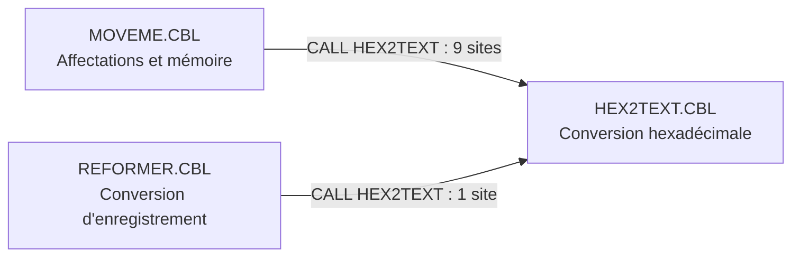
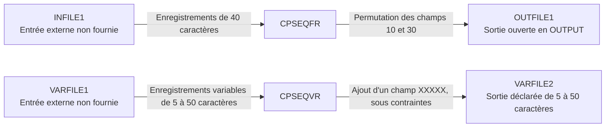

# Documentation technique du projet COBOL

## Table des matières

- [1. Introduction](#1-introduction)
- [2. Cartographie des liens entre programmes](#2-cartographie-des-liens-entre-programmes)
- [3. Analyse détaillée par fichier](#3-analyse-détaillée-par-fichier)
- [4. Fichiers principaux à retenir](#4-fichiers-principaux-à-retenir)

## 1. Introduction

### 1.1 Contexte

Le dépôt `AltecaGuillaumeG/test` contient quinze sources `.CBL`, toutes placées à la racine, et un modèle documentaire Word. Les commentaires des sources présentent explicitement des démonstrations du langage COBOL : affectations, représentations mémoire, conditions, chaînes, dates, fichiers séquentiels et calculs.

L'ensemble forme un **corpus technique cohérent**, organisé autour de mécanismes communs et d'un sous-programme partagé, `HEX2TEXT`. Sa cohésion est principalement pédagogique et technique : les fichiers ne démontrent ni une application métier intégrée, ni un enchaînement global de traitements. En particulier, les exemples de facture et de conversion d'enregistrement ne suffisent pas à établir l'existence d'un système de facturation.

Cette documentation repose sur une analyse statique des fichiers fournis. Le `PROGRAM-ID` est retenu comme identité déclarée du programme, même lorsqu'il contredit le nom du fichier. Les regroupements en niveaux techniques sont des **interprétations architecturales**, distinctes des appels effectivement codés.

### 1.2 Description fonctionnelle succincte

Le périmètre fonctionnel visible se répartit en quatre familles :

| Famille | Fonctions présentes | Programmes concernés |
|---|---|---|
| Manipulation et représentation des données | Saisie d'un nom, assemblage de texte, affectations, inspection hexadécimale, conversion d'un enregistrement d'exemple | `HELLO`, `STRINGIT`, `MOVEME`, `HEX2TEXT`, `REFORMER` |
| Conditions et indicateurs | Comparaisons, sélections multiples, conditions de niveau 88, conventions pseudo-booléennes | `COND88`, fichier `IFEVAL.CBL`, `NOTBOOL` |
| Dates et fichiers | Lecture de l'horloge système, présentation de dates, transformation d'enregistrements séquentiels fixes ou variables | `DATE1`, `DATE2`, `CPSEQFR`, `CPSEQVR` |
| Calculs spécialisés | Totalisation d'une facture fictive, attraction gravitationnelle, échauffement de freins | `INVCALC`, `ATTRACT`, `BRAKES` |

La plupart des données d'exemple sont définies dans les programmes. `HELLO` et `ATTRACT` sollicitent une saisie ; `CPSEQFR` et `CPSEQVR` utilisent des fichiers externes ; les programmes de dates lisent l'horloge système. `COND88`, `IFEVAL.CBL` et `NOTBOOL` ne produisent aucune sortie explicite. `HEX2TEXT` restitue son résultat dans le groupe reçu en paramètre.

## 2. Cartographie des liens entre programmes

### 2.1 Niveaux techniques et organisation implicite

Le classement suivant décrit une progression de complexité et des responsabilités, **pas des couches d'exécution imposées**.

| Niveau de lecture | Fichiers | Rôle dans l'ensemble |
|---|---|---|
| Base : service partagé | `HEX2TEXT.CBL` | Rendre visibles les octets manipulés par les exemples d'affectation et de conversion. |
| Base : mécanismes élémentaires | `HELLO.CBL`, `MOVEME.CBL`, `STRINGIT.CBL`, `COND88.CBL`, `IFEVAL.CBL`, `NOTBOOL.CBL` | Illustrer les opérations sur les données, les conditions et les représentations. `MOVEME` s'appuie sur le service partagé. |
| Intermédiaire : préparation et présentation | `REFORMER.CBL`, `DATE1.CBL`, `DATE2.CBL`, `CPSEQFR.CBL`, `CPSEQVR.CBL` | Combiner plusieurs mécanismes pour convertir un enregistrement, présenter une date ou transformer un flux séquentiel. |
| Spécialisé : calculs de domaine | `INVCALC.CBL`, `ATTRACT.CBL`, `BRAKES.CBL` | Appliquer les opérations numériques à des scénarios commerciaux, scientifiques ou d'ingénierie. |

Quatorze fichiers déclarent une `PROCEDURE DIVISION` sans paramètre. Seul `HEX2TEXT.CBL` expose une `LINKAGE SECTION` et une `PROCEDURE DIVISION USING`. Aucun programme maître, ordonnanceur ou lanceur commun n'est fourni.

Les rapprochements fonctionnels ne doivent pas être confondus avec des dépendances :

- `REFORMER` et `INVCALC` manipulent des attributs de facture, mais aucun appel ni transfert d'enregistrement entre eux n'est codé ; leurs structures ne constituent pas une interface partagée.
- `DATE1` et `DATE2` proposent deux méthodes d'acquisition des dates et dupliquent localement des tables de présentation ; ils ne s'appellent pas.
- `CPSEQFR` et `CPSEQVR` suivent un même modèle lecture-transformation-écriture, avec des formats distincts ; aucune chaîne entre leurs fichiers n'est définie.
- Les conditions de niveau 88 et les opérations sur les chaînes réapparaissent dans plusieurs programmes, sans bibliothèque commune ni instruction `COPY`.

### 2.2 Graphe des appels réellement présents

Ce graphe couvre les dix instructions `CALL` du dépôt et leurs deux relations appelant-appelé. Les douze autres fichiers ne contiennent aucun `CALL`. Les `PERFORM` rencontrés exécutent des blocs ou paragraphes locaux, et non d'autres programmes.

### 2.3 Contrat du service partagé HEX2TEXT

`MOVEME` et `REFORMER` déclarent chacun un groupe `WS-HEX2TEXT-CONVERSION`, transmis à `LS-HEX2TEXT-CONVERSION` dans `HEX2TEXT`. Le passage par référence est implicite : aucun `BY CONTENT` ou `BY VALUE` n'est spécifié.

| Champ dans l'appelant / l'appelé | Déclaration | Rôle |
|---|---|---|
| `WS-ORIGINAL-LENGTH` / `LS-ORIGINAL-LENGTH` | `PIC S9(09) COMP` | Nombre d'octets à convertir, noté `N`. |
| `WS-ORIGINAL-VALUE` / `LS-ORIGINAL-VALUE` | `PIC X(120)` | Zone source contenant les octets à examiner. |
| `WS-RESULT` / `LS-RESULT` | `PIC X(240)` | Zone destinée aux deux caractères hexadécimaux de chaque octet. |

Les tailles impliquent une borne de cohérence de **0 à 120 octets**, non contrôlée dans le sous-programme. Le résultat utile attendu occupe `2 × N` caractères, avec les symboles `0` à `9` et `A` à `F`. La partie restante de la zone résultat n'est pas réinitialisée.

La structure est recopiée dans les trois sources, sans copybook : sa cohérence doit être maintenue entre appelants et appelé. L'algorithme repose aussi sur des hypothèses de représentation binaire détaillées en section 3.9.

### 2.4 Flux de fichiers et éléments absents du dépôt

Les noms ci-dessous proviennent des clauses `ASSIGN TO`. Ils ne prouvent pas l'existence de chemins physiques, de définitions de fichiers ou d'affectations JCL.

| Élément non fourni | Référence | Nature et conséquence |
|---|---|---|
| `INFILE1` | `CPSEQFR.CBL`, `SELECT INFILE` | Entrée externe à fournir au format fixe attendu. |
| `OUTFILE1` | `CPSEQFR.CBL`, `SELECT OUTFILE` | Destination de sortie ; son ouverture en `OUTPUT` est codée, mais aucun exemplaire ni paramétrage n'est fourni. |
| `VARFILE1` | `CPSEQVR.CBL`, `SELECT INFILE` | Entrée externe variable, à fournir avec des longueurs compatibles avec le traitement. |
| `VARFILE2` | `CPSEQVR.CBL`, `SELECT OUTFILE` | Destination de sortie variable ; aucun exemplaire ni paramétrage n'est fourni. |
| `MOVE-notes.md` | Commentaire d'en-tête de `MOVEME.CBL`, ligne 12 | Document explicatif annoncé mais absent ; ce n'est pas une dépendance d'exécution. |

**Appels vers des programmes absents : aucun.** L'unique cible des `CALL`, `HEX2TEXT`, est présente. Aucune instruction `COPY` n'est codée et aucun fichier `.cpy` n'est fourni.

`CURRENT-DATE`, `REVERSE`, `SQRT`, `ATAN`, `COS` et `SIN` sont utilisés comme fonctions intrinsèques COBOL, et non comme sous-programmes manquants. `ATAN2` n'apparaît que dans un commentaire. Les liens web des en-têtes de `BRAKES` et de `HEX2TEXT` sont des références explicatives, pas des appels réseau.

### 2.5 Contraintes d'intégration visibles

- **Construction non définie :** aucun script de compilation, manifeste, JCL, configuration d'exécution ou test n'est fourni. Les commentaires mentionnent notamment QSAM, GnuCOBOL et IBM Enterprise COBOL, sans fixer un environnement cible commun.
- **Identité incohérente :** `IFEVAL.CBL` déclare `PROGRAM-ID. COND88`, comme `COND88.CBL`. Les quinze sources portent donc quatorze identifiants distincts ; leur regroupement dans une même construction peut créer une collision. Le nom de fichier ne corrige pas cette déclaration.
- **Résolution du service partagé :** l'exécution de `MOVEME` et de `REFORMER` nécessite que `HEX2TEXT` soit accessible selon le mécanisme de liaison ou de chargement choisi, non précisé dans le dépôt.
- **Portabilité des données :** les démonstrations mémoire utilisent `COMP`, `COMP-1`, `COMP-2`, `COMP-3` et des vues alphanumériques. L'ordre des octets, les représentations numériques et le jeu de caractères influencent les résultats observables.

Aucun accès à une base de données, échange interprocessus ou service applicatif distant n'est codé. Les limites relevées ci-dessous interdisent de considérer les exemples comme une chaîne de production validée.

## 3. Analyse détaillée par fichier

### 3.1 ATTRACT.CBL

**Programme déclaré :** `ATTRACT` ([source](ATTRACT.CBL#L17)).

- **Objectif fonctionnel :** saisir les caractéristiques de deux corps, les réafficher pour confirmation, puis calculer leur distance et la valeur de leur attraction gravitationnelle. La saisie et les résultats passent par `ACCEPT` et `DISPLAY`.
- **Structures clés :** `Body OCCURS 2 INDEXED BY BodyIx` regroupe masse, vitesses `vx`/`vy` et positions `px`/`py`. Les constantes, distances, forces et résultats intermédiaires sont en `COMP-2`.
- **Mécanismes COBOL :** `PERFORM VARYING`, paragraphes `SolicitAttributesOfBody`, `VerifyAttributesOfBody` et `ComputeAttraction`, `COMPUTE`, fonctions `SQRT`, `ATAN`, `COS`, `SIN`, conditions et `GOBACK`. Une réponse `n`/`N` interrompt le traitement ; une distance nulle est explicitement détectée.
- **Relations :** aucun appel interprogramme ni fichier externe. Proximité technique avec `BRAKES` pour les calculs flottants, sans dépendance d'exécution.
- **Points d'attention :** la norme de la force suit `G × mass(1) × mass(2) / d²`. Le calcul directionnel est explicitement qualifié d'erroné dans le commentaire : le code exécute `theta = ATAN(dx)`, puis `COS(theta × f)` et `SIN(theta × f)`. Les vitesses saisies ne servent pas au calcul ; aucune évolution temporelle n'est simulée.

### 3.2 BRAKES.CBL

**Programme déclaré :** `BRAKES` ([source](BRAKES.CBL#L15)).

- **Objectif fonctionnel :** calculer une élévation de température de freins pour un scénario de descente fixé dans le programme, puis l'afficher. Il ne s'agit pas d'une température finale incluant une température initiale.
- **Structures clés :** `GIVEN-VALUES` contient la masse des freins `m = 100`, la chaleur spécifique `sh = 800`, la masse du camion `w = 10000`, le dénivelé `d = 75` et l'accélération `a = 9.8`. `CALCULATED-VALUES` reçoit les résultats en `COMP-2` et une zone d'édition `PIC Z,ZZ9.99`.
- **Mécanismes COBOL :** `COMPUTE Mgh = w × a × d`, `COMPUTE mc = m × sh`, puis `deltaT-Celsius = Mgh / mc`, `MOVE` vers une zone numérique éditée, `DISPLAY` et `GOBACK`.
- **Relations :** exemple autonome, sans paramètre, saisie, fichier ni appel. Même famille de calcul scientifique que `ATTRACT`.
- **Points d'attention :** les données sont constantes. Aucun modèle de dissipation ni contrôle d'erreur arithmétique n'est codé ; l'édition ne conserve que deux décimales et ne spécifie pas d'arrondi.

### 3.3 COND88.CBL

**Programme déclaré :** `COND88` ([source](COND88.CBL#L14)).

- **Objectif fonctionnel :** illustrer les noms de condition de niveau 88, sans sortie explicite. Les résultats successifs sont placés dans `THE-ANSWER`.
- **Structures clés :** indicateurs simples, condition avec clause `FALSE`, `CATEGORY-CODE` associé à plusieurs valeurs possibles, et `PERSON-AGE` associé à des plages `THRU`.
- **Mécanismes COBOL :** `SET ... TO TRUE/FALSE`, `IF`, négation de condition et `EVALUATE TRUE`. Le niveau 88 qualifie la valeur du champ auquel il est rattaché ; il ne définit pas un stockage indépendant.
- **Relations :** référence technique pour les indicateurs également employés dans `NOTBOOL`, `INVCALC`, `REFORMER` et les statuts des copieurs séquentiels. Aucun appel entre ces programmes.
- **Points d'attention :** l'observation du comportement repose sur la lecture ou l'inspection des données, pas sur un affichage. Son `PROGRAM-ID` est également déclaré dans `IFEVAL.CBL`.

### 3.4 CPSEQFR.CBL

**Programme déclaré :** `CPSEQFR` ([source](CPSEQFR.CBL#L15)).

- **Objectif fonctionnel :** lire `INFILE1`, permuter les deux champs de chaque enregistrement et écrire `OUTFILE1`. La transformation est `[champ de 10 caractères][champ de 30 caractères]` vers `[champ de 30 caractères][champ de 10 caractères]`.
- **Structures clés :** deux `FD` de 40 caractères en `RECORDING MODE F`, zones d'entrée et de sortie découpées selon cette permutation, statuts `PIC X(02)` et compteur `RECORD-COUNT PIC S9(5) COMP-3`.
- **Mécanismes COBOL :** `SELECT ... ASSIGN TO`, `OPEN INPUT/OUTPUT`, `READ`, `MOVE`, `WRITE`, `CLOSE`, conditions de niveau 88 pour les statuts `00` et `10`, boucle jusqu'à fin de fichier et sortie par `GO TO END-OF-PROGRAM`. Le compteur est incrémenté après une écriture de statut `00`.
- **Relations :** aucun appel ; dépend uniquement des affectations de fichiers externes. `CPSEQVR` en est le pendant technique pour les longueurs variables, sans lien de données codé.
- **Points d'attention :** le compteur n'est pas explicitement initialisé. Un échec d'ouverture de sortie est affiché sans arrêt immédiat ; un statut de lecture autre que `00` ou `10` n'est pas traité. Les deux fichiers sont fermés sans mémoriser lesquels ont effectivement été ouverts.

### 3.5 CPSEQVR.CBL

**Programme déclaré :** `CPSEQVR` ([source](CPSEQVR.CBL#L15)), malgré l'en-tête commenté qui annonce `CPSEQFR`.

- **Objectif fonctionnel :** lire `VARFILE1`, interpréter chaque enregistrement comme une succession de champs de cinq caractères, ajouter le champ `XXXXX`, puis écrire `VARFILE2` et afficher un compteur.
- **Structures clés :** deux `FD` en `RECORDING MODE V`, longueurs déclarées de 5 à 50 via `DEPENDING ON IN-RECLEN/OUT-RECLEN`, tampons de 50 caractères et table `RECORD-FIELD OCCURS 1 TO 10 DEPENDING ON FIELD-COUNT`.
- **Mécanismes COBOL :** lecture séquentielle pilotée par `FILE STATUS`, calcul de `FIELD-COUNT = IN-RECLEN / 5`, copie vers `RECORD-AREA`, ajout d'une occurrence et `WRITE ... FROM RECORD-AREA`.
- **Relations :** exemple autonome, sans appel. Même schéma de traitement que `CPSEQFR`, mais formats et affectations de fichiers différents.
- **Points d'attention :** l'ajout suppose une longueur d'entrée multiple de cinq et au plus égale à **45**, sans contrôle explicite. Une entrée de 50 conduit à une onzième occurrence et à une sortie de 55, hors limites déclarées. Le compteur n'est pas explicitement initialisé et est incrémenté sans contrôle du statut après `WRITE` ; les erreurs de lecture hors fin de fichier ne sont pas traitées.

### 3.6 DATE1.CBL

**Programme déclaré :** `DATE1` ([source](DATE1.CBL#L14)).

- **Objectif fonctionnel :** acquérir la date et l'heure système via `FUNCTION CURRENT-DATE`, puis afficher un horodatage de type NCSA, une date textuelle anglaise et les formats courts `MM/DD/YY` et `DD.MM.YY`.
- **Structures clés :** `CURRENT-DATE-DATA` sépare date, heure et décalage de fuseau ; `REDEFINES` décompose l'année en siècle et année courte. Des groupes de sortie portent les séparateurs, et deux tables contiennent les douze mois et dix suffixes ordinaux.
- **Mécanismes COBOL :** fonction intrinsèque, `MOVE CORRESPONDING`, qualification des noms, `REDEFINES`, `OCCURS`, division avec reste et `STRING`.
- **Relations :** aucun appel. `DATE2` présente une acquisition alternative ; `REFORMER` emploie aussi `CURRENT-DATE`, sans réutiliser ce programme.
- **Points d'attention :** `DAY-LAST-DIGIT` vaut de 0 à 9, mais indexe directement une table numérotée de 1 à 10 : zéro est hors bornes et les suffixes sont décalés. Aucun traitement particulier des jours 11 à 13 n'est codé. La zone nommée `MILLISECONDS` n'a que deux chiffres ; son nom ne démontre pas une précision à la milliseconde.

### 3.7 DATE2.CBL

**Programme déclaré :** `DATE2` ([source](DATE2.CBL#L14)).

- **Objectif fonctionnel :** acquérir les représentations système de date, jour dans l'année, jour de semaine et heure via `ACCEPT FROM`. Afficher une date textuelle anglaise, deux dates courtes et l'heure avec centièmes de seconde.
- **Structures clés :** `DATE-DATA` contient les représentations `YYMMDD`, `YYYYMMDD`, `YYDDD`, `YYYYDDD`, le jour de semaine et l'heure ; tables des mois, suffixes ordinaux et sept noms de jours ; groupes de présentation.
- **Mécanismes COBOL :** `ACCEPT FROM DATE`, `DATE YYYYMMDD`, `DAY`, `DAY YYYYDDD`, `DAY-OF-WEEK` et `TIME`, puis `DIVIDE ... REMAINDER`, `STRING`, `MOVE` et `DISPLAY`.
- **Relations :** variante autonome de `DATE1`. Les tables communes par leur contenu sont redéclarées, sans appel ni copybook partagé.
- **Points d'attention :** même défaut d'indexation des suffixes ordinaux que `DATE1`, sans exception pour 11 à 13. Les représentations du jour dans l'année sont acquises mais ne sont pas utilisées dans les affichages. Les acquisitions successives ne sont pas regroupées dans une lecture unique de l'horloge.

### 3.8 HELLO.CBL

**Programme déclaré :** `HELLO` ([source](HELLO.CBL#L15)).

- **Objectif fonctionnel :** demander un nom et afficher un message de la forme `Hello, <nom>!`, sans insérer les espaces de fin du champ de saisie avant le point d'exclamation.
- **Structures clés :** `WS-FRIEND PIC X(80)`, message de sortie de 120 caractères, fragments de salutation et compteur d'espaces `COMP-3` initialisé à zéro.
- **Mécanismes COBOL :** `ACCEPT`, `INSPECT FUNCTION REVERSE(...) TALLYING ... FOR LEADING SPACES`, découpe par modification de référence et `STRING ... DELIMITED BY SIZE`.
- **Relations :** aucun appel. Introduction aux opérations de texte approfondies dans `STRINGIT` et combinées dans `REFORMER`.
- **Points d'attention :** aucune gestion dédiée d'une saisie vide ou entièrement composée d'espaces. Dans ce cas, la longueur calculée pour la découpe devient nulle ; le code ne prévoit pas de branche particulière.

### 3.9 HEX2TEXT.CBL

**Programme déclaré :** `HEX2TEXT` ([source](HEX2TEXT.CBL#L9)).

- **Objectif fonctionnel :** transformer les octets d'une zone fournie par l'appelant en caractères hexadécimaux, sans affichage propre ni accès fichier.
- **Structures clés :** interface `LS-HEX2TEXT-CONVERSION` décrite en section 2.3, table `HEXSTR = "0123456789ABCDEF"`, entier binaire `DEC PIC S9(4) COMP` et vue `REDEFINES` contenant `DECBYTE`.
- **Mécanismes COBOL :** `LINKAGE SECTION`, `PROCEDURE DIVISION USING`, boucle `PERFORM VARYING`, vues mémoire superposées, division par 16 avec quotient et reste, écriture de deux caractères par modification de référence, puis `GOBACK`.
- **Relations :** seul sous-programme explicitement appelé ; neuf sites d'appel dans `MOVEME`, un dans `REFORMER`. Les appelants fournissent la longueur et la zone source, puis exploitent le résultat dans le même groupe.
- **Points d'attention :** aucun contrôle de longueur ni initialisation de l'ensemble du résultat. Le déplacement d'un octet dans le second caractère de la vue de `DEC` suppose une taille et un ordre des octets compatibles ; l'autre octet n'est pas explicitement remis à zéro. La conversion ne peut donc pas être considérée comme indépendante de la représentation mémoire du compilateur.

### 3.10 IFEVAL.CBL

**Programme déclaré :** `COND88`, et non `IFEVAL` ([source](IFEVAL.CBL#L14)). `IFEVAL` est le nom du fichier et celui annoncé dans son commentaire d'en-tête.

- **Objectif fonctionnel :** illustrer les comparaisons alphanumériques et numériques, la vérification d'une donnée numérique et le choix entre branches simples ou multiples. Aucune sortie n'est émise.
- **Structures clés :** `RESULT-OF-COMPARE PIC X(10)`, deux zones alphanumériques et deux nombres `COMP-3`. `NUMERIC-2-X` permet d'écrire une valeur alphanumérique dans le groupe contenant `NUMERIC-2`.
- **Mécanismes COBOL :** variantes de `IF/ELSE`, portées terminées par point ou `END-IF`, test de classe `IS NUMERIC`, garde avant division, `EVALUATE TRUE`, `EVALUATE TRUE ALSO TRUE` et modification de référence.
- **Relations :** complément technique de `COND88` et de `NOTBOOL`, sans appel. Son identité déclarée entre en collision avec celle de `COND88.CBL`.
- **Points d'attention :** une branche du dernier `EVALUATE` compare `NUMERIC-1` à lui-même, et non à `NUMERIC-2` ; elle ne vérifie donc pas l'égalité des deux nombres. Plusieurs messages dépassent les dix caractères de `RESULT-OF-COMPARE` et sont tronqués par l'affectation.

### 3.11 INVCALC.CBL

**Programme déclaré :** `INVCALC` ([source](INVCALC.CBL#L12)).

- **Objectif fonctionnel :** construire une facture fictive de trois lignes, calculer les montants avant taxe, taxe et total, puis afficher l'en-tête et le détail. Aucun chargement de facture depuis un fichier ou un paramètre n'est codé.
- **Structures clés :** groupe `INVOICE` avec date, numéro, totaux, indicateur de retour et table de 1 à 100 lignes selon `INV-LINE-ITEM-COUNT`. Prix, quantités, cumuls et taux de taxe de `0.065` sont principalement en `COMP-3`. `INVOICE-FORMATTED` porte les zones d'édition.
- **Mécanismes COBOL :** `INITIALIZE ... REPLACING`, niveaux 88 `TAXABLE-ITEM`, `NONTAXABLE-ITEM` et `IS-RETURN`, boucle indicée, tests `IS NUMERIC`, `MULTIPLY`, `ADD`, paragraphes de diagnostic et d'impression, édition monétaire et découpe de date.
- **Relations :** exemple spécialisé autonome. Les notions de facture, quantité, prix et taxable sont proches de `REFORMER`, mais aucune interface ni séquence `REFORMER` vers `INVCALC` n'existe dans le code.
- **Points d'attention :** le chargement de la troisième ligne exécute à nouveau `SET TAXABLE-ITEM(1) TO TRUE` ; il ne rend pas la troisième ligne taxable. Les taxes sont stockées sur trois décimales, les totaux monétaires sur deux, sans `ROUNDED`. Les données non numériques déclenchent un affichage sans arrêt global. `IS-RETURN` ne commande qu'un message, pas un calcul d'avoir.

### 3.12 MOVEME.CBL

**Programme déclaré :** `MOVEME` ([source](MOVEME.CBL#L16)).

- **Objectif fonctionnel :** montrer les effets de `MOVE` sur différentes représentations numériques et alphanumériques, ainsi que la différence entre `INITIALIZE` et l'écrasement d'un groupe par des espaces. Les résultats sont affichés en texte ou en hexadécimal.
- **Structures clés :** éléments `COMP`, `COMP-1`, `COMP-2`, `COMP-3`, numériques `DISPLAY` et numériques édités, enveloppes de groupe permettant de lire leurs octets comme du texte, groupe composite avec table variable et interface `WS-HEX2TEXT-CONVERSION`.
- **Mécanismes COBOL :** affectations élémentaires ou de groupes, `INITIALIZE ... REPLACING`, `LENGTH OF`, modification de référence, `CALL ... USING` et `DISPLAY`.
- **Relations :** neuf sites d'appel à `HEX2TEXT` pour convertir les représentations mémoire. Ce même mécanisme est réutilisé par `REFORMER` ; aucun appel direct entre les deux démonstrateurs.
- **Points d'attention :** le programme annonce lui-même des différences ASCII/EBCDIC. Les résultats mémoire dépendent aussi du compilateur. L'exemple de flottant externe est commenté. `WS-TABLE-SIZE` n'est pas positionné à une valeur de 1 à 4 après l'initialisation du groupe variable ; ne pas supposer que celui-ci contient toujours quatre occurrences actives. Le document annoncé `MOVE-notes.md` est absent.

### 3.13 NOTBOOL.CBL

**Programme déclaré :** `NOTBOOL` ([source](NOTBOOL.CBL#L15)).

- **Objectif fonctionnel :** illustrer les conventions historiques simulant des booléens et leurs opérations de positionnement, test et basculement. Aucune sortie n'est produite.
- **Structures clés :** indicateurs `PIC X` fondés sur `T`/espace, `Y`/`N`, `1`/`0`, noms de condition de niveau 88 avec ou sans clause `FALSE`, et indicateurs numériques `COMP-3` fondés sur `1` et `-1`.
- **Mécanismes COBOL :** `MOVE`, `IF`, `EVALUATE TRUE`, `SET ... TO TRUE/FALSE` et `COMPUTE`. Les exemples de types `BIT` et de littéraux booléens sont entièrement commentés.
- **Relations :** approfondissement des conventions également illustrées par `COND88` et employées ailleurs sous forme de niveaux 88. Aucun appel interprogramme.
- **Points d'attention :** la branche `ELSE` du basculement de `EX6-FLAG` positionne `EX5-FLAG`, pas `EX6-FLAG`. Le calcul final `EX7-FLAG × -EX7-FLAG` produit `-1` pour les valeurs `1` et `-1` : ce n'est pas un basculement général entre les deux états. Les commentaires de compatibilité des exemples désactivés ne constituent pas une validation multiplateforme.

### 3.14 REFORMER.CBL

**Programme déclaré :** `REFORMER` ([source](REFORMER.CBL#L15)).

- **Objectif fonctionnel :** convertir un enregistrement fournisseur fictif, construit en mémoire, vers un format interne : date, référence produit, indicateur taxable, quantité, prix et numéro de facture. Le résultat est affiché en texte et en représentation hexadécimale ; aucun fichier d'entrée ou de sortie n'est déclaré.
- **Structures clés :** `INPUT-RECORD` avec champs de type `DISPLAY`, `OUTPUT-RECORD` de 73 octets comprenant des nombres `COMP-3`, table de cinq correspondances de préfixes produit, zones de travail de date et groupe d'échange avec `HEX2TEXT`. Deux lignes hexadécimales séparent les chiffres hexadécimaux de poids fort et faible de chaque octet.
- **Mécanismes COBOL :** `UNSTRING` de la date, `FUNCTION CURRENT-DATE`, `SEARCH` sur table indexée redéfinie, `STRING` pour le SKU, `SET` d'une condition 88, conversions par `MOVE`, modifications de référence et boucle de présentation.
- **Relations :** un appel à `HEX2TEXT` pour examiner le résultat converti. Proximité de vocabulaire avec `INVCALC`, et de mécanismes avec `STRINGIT` et `DATE1`, sans appel à ces programmes.
- **Points d'attention :** le siècle est repris de la date système, sans règle de pivot. Le champ nommé `OUT-INV-DATE-YYYY-MM-DD` contient huit caractères `YYYYMMDD`, sans tirets. `SKU-INDEX` n'est pas explicitement positionné avant `SEARCH`. `OUT-ITEM-DESC` n'est jamais alimenté depuis la description entrante. Malgré l'en-tête, aucune instruction `INSPECT REPLACING` n'est exécutée.

### 3.15 STRINGIT.CBL

**Programme déclaré :** `STRINGIT` ([source](STRINGIT.CBL#L14)).

- **Objectif fonctionnel :** afficher plusieurs assemblages d'un nom défini dans le programme, en comparant champs fixes, longueurs calculées, concaténation et extraction de la partie utile.
- **Structures clés :** trois composantes de nom de 60 caractères, groupe de sortie réordonné, compteurs de longueur `COMP-3` et zone de sortie de 180 caractères.
- **Mécanismes COBOL :** `MOVE` vers un groupe à champs fixes, `INSPECT TALLYING ... BEFORE INITIAL SPACE`, `INITIALIZE` des compteurs, `STRING` avec `DELIMITED BY SPACE` ou `SIZE`, calcul de longueur et modification de référence.
- **Relations :** aucun appel. Approfondit les opérations de texte de `HELLO` ; les mêmes mécanismes d'assemblage sont combinés avec d'autres conversions dans `REFORMER`.
- **Points d'attention :** la recherche du premier espace et les concaténations délimitées par espace ne constituent pas une gestion générale des noms composés. L'en-tête cite `UNSTRING`, mais aucune instruction `UNSTRING` n'est présente dans le traitement.

## 4. Fichiers principaux à retenir

| Fichier non COBOL | Rôle dans le dépôt |
|---|---|
| [documentation Type COBOL.docx](documentation%20Type%20COBOL.docx) | Modèle de documentation avec rubriques de contexte, description fonctionnelle, cartographie, impacts, description des programmes et historique. Ses mentions d'appelant maître et d'appelé esclave sont un canevas, pas la preuve d'une hiérarchie implémentée. |
| [documentation COBOL.md](documentation%20COBOL.md) | Présente documentation technique : architecture observable, cartographie des appels et des flux, contrats de données, analyse des quinze sources et limites visibles. |

Aucun autre fichier de support applicatif n'est fourni : pas de README, copybook, script de construction, JCL, jeu de données ni résultat d'exécution. Le modèle Word ne décrit pas de règles métier supplémentaires permettant de compléter les traitements absents du code.
